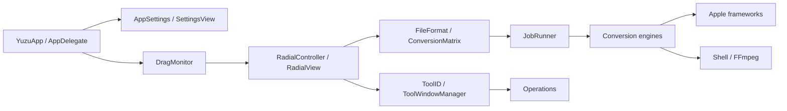
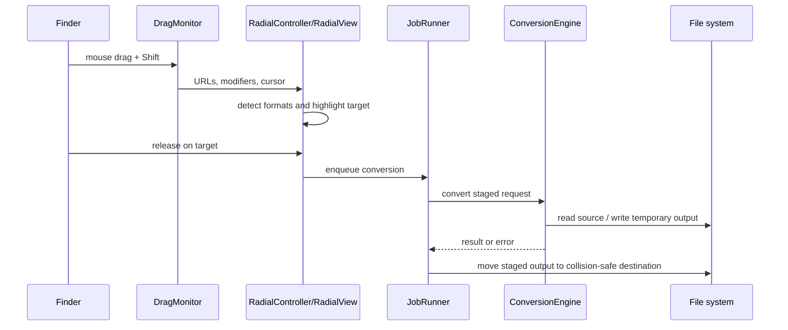
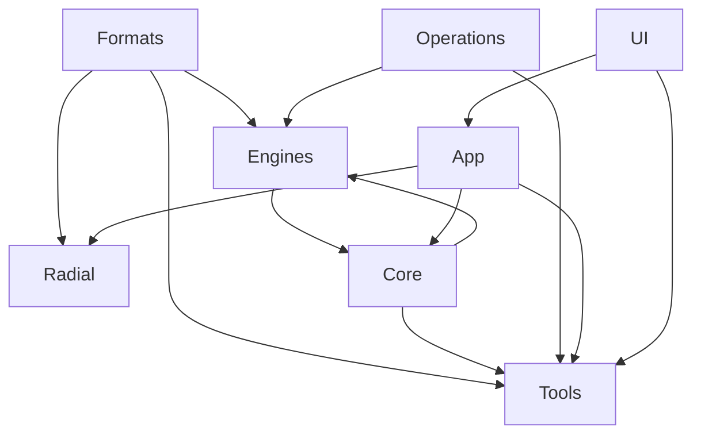
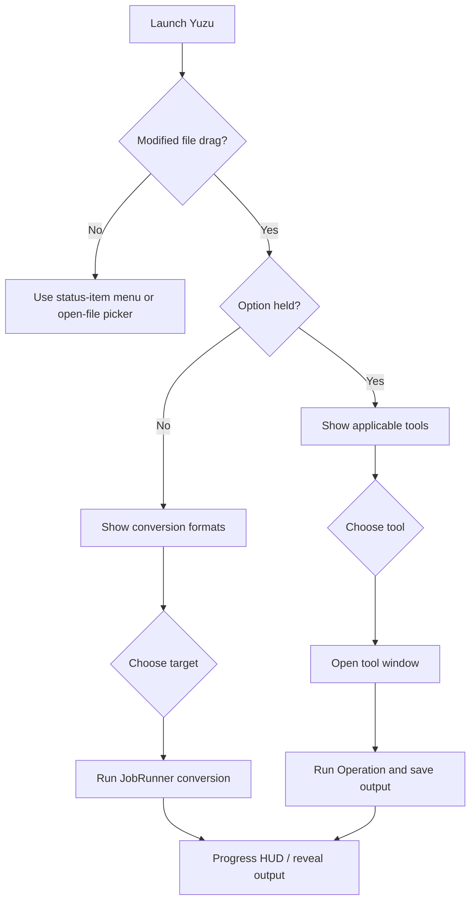

# Yuzu architecture

## System overview

Yuzu is a menu-bar macOS accessory application. `YuzuApp` in `Sources/App.swift` creates the Settings scene and installs `AppDelegate`. `AppDelegate` configures the accessory activation policy, status-item menu, settings window, appearance, and drag monitor. The application has no network service or server component in this repository.

## Lifecycle and UI

`Sources/App.swift` is the `@main` entry point. On launch, `AppDelegate.applicationDidFinishLaunching` starts `DiagnosticLog`, applies `AppSettings`, creates the status item, and starts `DragMonitor` unless screenshot automation is enabled. The status item opens file pickers, tools, settings, logs, and the About panel.

SwiftUI owns Settings, the radial wheel content, tool views, previews, and progress HUD content. AppKit supplies the application delegate, status item, panels, event monitors, drag destination view, native file panels, and window behavior. `Sources/UI/Theme.swift` centralizes the orange accent, semantic label colors, and card surface modifier.

## Drag-and-drop and radial interaction

`Sources/Radial/DragMonitor.swift` observes global mouse down/drag/up events and polls the drag pasteboard. It detects Finder drags, modifier changes, file URLs, and the fallback movement heuristic. `RadialController` maps those events to a `RadialPanel`, detects formats, and chooses either conversion targets or applicable `ToolID` values.

`Sources/Radial/RadialView.swift` is an AppKit drag destination and mouse/keyboard interaction surface. Escape cancels, Return applies the highlighted item, arrow keys move selection, and mouse movement or drag location updates the highlighted wedge. Option switches between conversion and advanced-tool modes while the drag is active.

## Conversion workflow

`FileFormat.detect` identifies supported formats from extensions and aliases. `ConversionMatrix` computes targets, intersections for mixed selections, output names, collision suffixes, and the 190-option total. `JobRunner` creates one asynchronous job per source, limits concurrency with `AsyncSemaphore(limit: 2)`, reports progress, reveals outputs when configured, and presents a card or pill HUD.

`Sources/Engines/ConversionEngine.swift` selects the first supporting engine, writes into a hidden `.yuzu-UUID` sibling, checks cancellation, and moves the completed file or directory into the destination. Native engines cover images, AVFoundation media, documents, subtitles, and archives; FFmpeg is invoked for unsupported native formats.

## Modules

- `Sources/Core`: jobs, progress HUD, subprocess wrapper, media probing, diagnostics, and `YuzuError`.
- `Sources/Engines`: conversion protocol and image, audio, video, document, subtitle, archive, AVFoundation, DOCX, and FFmpeg implementations.
- `Sources/Operations`: advanced-tool backends for images, video, audio, PDFs, metadata, and compression.
- `Sources/Formats`: supported formats, type mapping, conversion matrix, and output naming.
- `Sources/Tools`: SwiftUI tool windows, previews, tool registry, and window manager.
- `Sources/Radial`: global drag tracking, radial controller, panel, shape, and interaction handling.

## Temporary files, errors, and limitations

Temporary work is created under `FileManager.default.temporaryDirectory` or next to the requested destination for atomic staging. Most paths use `defer` cleanup; conversion staging is removed on failure. Errors propagate as `YuzuError`, cancellation, or underlying errors into `JobRunner`.

Current limitations include extension-based format detection, reliance on external FFmpeg/unar availability for some formats, global event monitoring, an unsigned ad-hoc signing configuration, no declared sandbox entitlement in the repository, and no runtime Finder-drag test on CI. Archive extraction and overwrite behavior deserve additional security hardening before broader distribution.

## Extensibility

Add a format by updating `FileFormat`, its aliases/type mapping, `ConversionMatrix`, the supporting engine, and tests. Add an advanced tool by updating `ToolID`, its applicability and UI registration, the relevant `Operations` backend, and tests. Keep new engines behind `ConversionEngine` and preserve staged output semantics.

## User interaction flow

