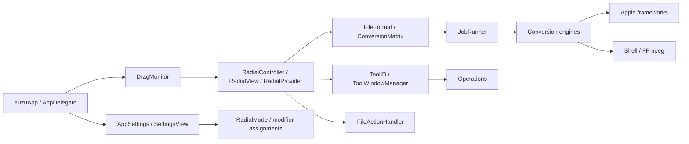
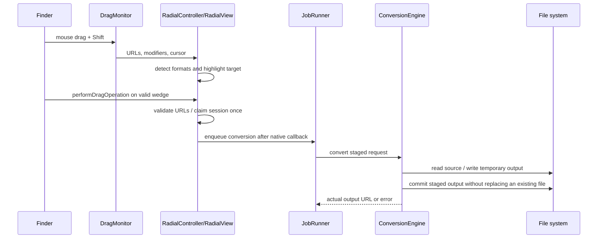
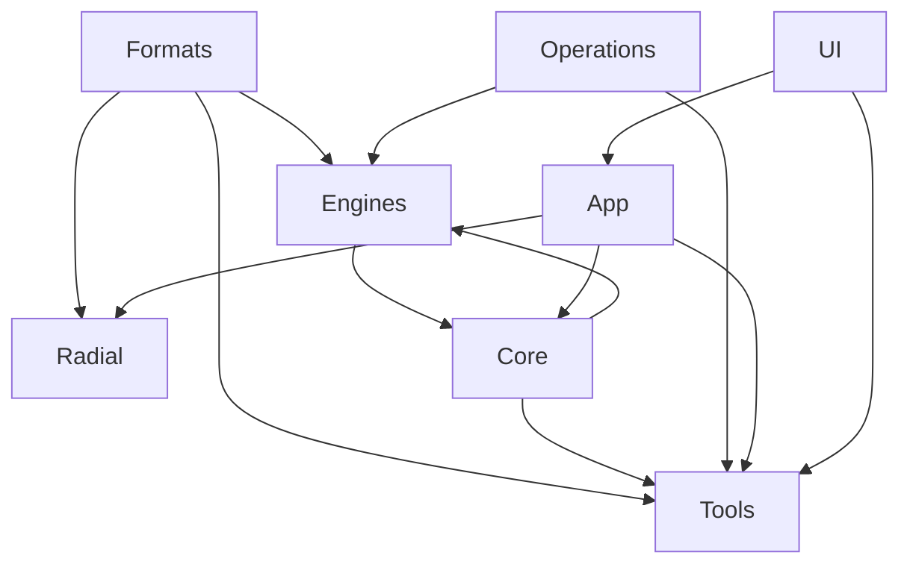
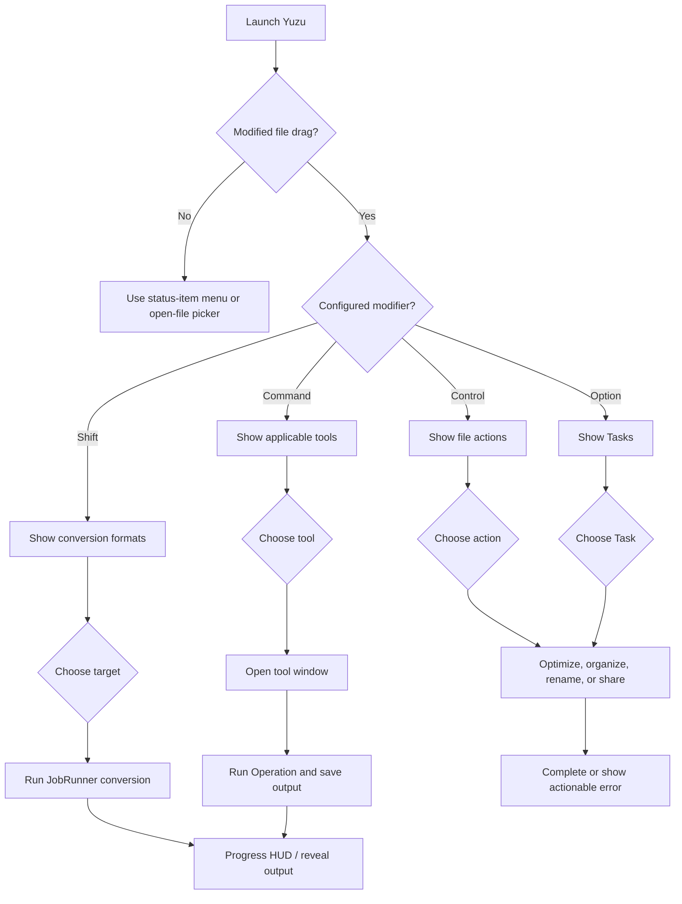

# Yuzu architecture

## System overview

Yuzu is a menu-bar macOS accessory application. `YuzuApp` in `Sources/App.swift` creates the Settings scene and installs `AppDelegate`. `AppDelegate` configures the accessory activation policy, status-item menu, settings window, appearance, and drag monitor. The application has no network service or server component in this repository.

## Lifecycle and UI

`Sources/App.swift` is the `@main` entry point. On launch, `AppDelegate.applicationDidFinishLaunching` starts `DiagnosticLog`, applies `AppSettings`, creates the status item, and starts `DragMonitor` unless screenshot automation is enabled. The status item opens file pickers, tools, settings, logs, and the About panel.

SwiftUI owns Settings, the radial wheel content, tool views, previews, and progress HUD content. AppKit supplies the application delegate, status item, panels, event monitors, drag destination view, native file panels, and window behavior. `Sources/UI/Theme.swift` centralizes the Yuzu Citrus Yellow/amber palette, semantic label colors, and card surface modifier.

## Drag-and-drop and radial interaction

`Sources/Radial/DragMonitor.swift` observes local/global mouse down/drag/up and modifier events, with one common-run-loop polling timer (30 Hz idle, 60 Hz during a press). A changed drag-pasteboard generation and existing file URLs are required before initial presentation; cursor movement alone does not confirm a drag. URLs are normalized and deduplicated, including folders. Main-actor delegate delivery preserves event order. The default modifiers are Shift for conversion, Command for tools, Control for actions, and Option for Tasks, with the legacy Shift+Option tools alias retained. Unmodified drags do not present a panel, and releasing a mode modifier retains the selected mode.

`Sources/Radial/RadialController.swift` presents one compact, nonactivating `RadialPanel` at a fixed anchor for the gesture. Its normal canvas is 364 × 364 points, clamped into the selected display's visible frame; changing modes replaces content without moving or scaling the panel. The entire compact content view is an AppKit drag destination, including the hub and gaps, so crossing between wedges does not remove the destination. `draggingEntered`/`draggingUpdated` and requested periodic native updates drive hover, supplemented by monitor cursor updates. The panel does not become key or activate Yuzu during external dragging. Picker presentation retains mouse, arrow-key, Return, Escape, and outside-click behavior.

`Sources/Radial/RadialDragSession.swift` owns `idle → dragging → radialPresented → hoveringWedge → committing → completed`, with `cancelled` and `failed` terminal states. The controller binds a session UUID to AppKit's dragging sequence number. Only `performDragOperation` can commit an external drop, after fresh destination URLs and the current wedge are checked. Commitment is claimed synchronously before dispatching the existing conversion/tool/file-action handler asynchronously. Terminal states clear URLs and retain the session ID to reject late or duplicate callbacks. Native drag completion without commitment cancels; observed physical mouse release schedules a 250 ms cancellation fallback and never executes an action itself.

`Sources/Radial/RadialView.swift` shares the actual rounded `WedgeShape` path between rendering and hit testing, including gaps and the single-item annulus. Screen points convert through the window and view, then flip y once into SwiftUI coordinates. No backing-pixel conversion is applied, including on Retina displays or displays with negative origins. The hub radius is 59 pt and the action ring starts at 65 pt. Full opaque Yuzu Yellow selection updates immediately, without interpolation that could diverge from hit targets. A light circular native Liquid Glass backing extends 8 pt past the action ring without changing wedge hit regions. White/silver translucent wedges and a white hub share the backing. The wheel keeps a local light color scheme and dark text even when the rest of the app is dark; Reduce Transparency replaces glass with opaque light surfaces. Theme tokens, reduced-transparency fills, increased-contrast outlines, and accessible labels are centralized or composed in the shared wheel. Drag captions show file context rather than duplicating Finder's filename; picker captions retain middle truncation.

These behaviors were inspected in source; Finder/Desktop interaction has not been manually verified. Finder owns its drag preview; Yuzu leaves it untouched and repeats the selected action on its wedge as well as the hub. The destination accepts copy or generic operations and rejects move-only masks to avoid telling the source to remove a file after conversion. A source modifier may need to be released before dropping; the chosen Yuzu mode remains selected. File promises are not registered because no asynchronous promise receiver is implemented. Native Escape completion, modifier changes, source-mask behavior, multiple displays, and Finder/Desktop delivery still require runtime verification. No new permission request or global key monitor was added.

Opt-in `YUZU_DEBUG_DRAG` logs session IDs, pasteboard generations and URL counts, panel presentation, modifier changes, native sequence/mask, coordinate conversions, hit results, hover changes, release, commitment, action execution, and cancellation. Coordinate logging is throttled to 250 ms; logging is disabled unless the environment variable is set. See `docs/DEVELOPMENT.md` for validation commands and results.

`Sources/Radial/RadialSelectionSound.swift` generates a 30 ms mono PCM click in memory and caches one `NSSound`. Visible hover and keyboard selection changes use the same feedback path; repeated updates, hub/gaps, and resets are silent. A 45 ms gate limits rapid sweeps. `AppSettings.radialSoundEnabled` defaults to true and persists the Settings > General toggle. No audio resource, network access, or new framework is required. The Option mode is displayed as Tasks; internal `.flow` identifiers and stored `flowModifier` preferences remain compatible.

## Conversion workflow

`FileFormat.detect` identifies supported formats from extensions and aliases. `ConversionMatrix` computes targets, intersections for mixed selections, output names, collision suffixes, and the 253-option total. `JobRunner` creates one asynchronous job per source, limits concurrency with `AsyncSemaphore(limit: 2)`, reports progress, reveals outputs when configured, and presents a card or pill HUD.

`Sources/Engines/ConversionEngine.swift` selects the first supporting engine, writes into a hidden `.yuzu-UUID` sibling, checks cancellation, and moves the completed file or directory into the destination. The dispatcher rejects unsupported matrix pairs and identical source/destination URLs, refuses to replace existing files, removes staging unconditionally, and returns the actual output URL (including multi-page image directories). `JobRunner` uses that URL for Reveal in Finder. Native engines cover images, AVFoundation media, documents, subtitles, and archives; FFmpeg is invoked for unsupported native media formats.

### Document, slide, and spreadsheet formats

| Input | Targets | Backend |
| --- | --- | --- |
| PDF | DOCX, PPTX, XLSX, JPG, PNG, EPUB, TXT, MD | Native PDFKit and package writers |
| TXT | PDF, JPG, PNG, SRT, VTT, DOCX, MD, EPUB, HTML | Native |
| MD, EPUB | PDF, DOCX, MD, TXT, EPUB, HTML, excluding self | Native text pipeline |
| DOCX | PDF, MD, TXT, EPUB, HTML | Optional LibreOffice |
| PAGES, RTF | PDF, DOCX, MD, TXT, EPUB, HTML | Optional LibreOffice, input only |
| RTFD | PDF, DOCX, MD, TXT, EPUB, HTML | AppKit text import, input only |
| PPT, PPTX | PDF, JPG, PNG | Optional LibreOffice, then native PDF rendering for images |
| XLSX, ODS | XLSX, ODS, CSV, TSV, PDF, excluding self | Optional LibreOffice |
| XLS | XLSX, ODS, CSV, TSV, PDF | Optional LibreOffice, input only |
| CSV, TSV | XLSX, ODS, CSV, TSV, PDF, excluding self | Native |

`PresentationWriter.swift` rasterizes each PDF page at 144 DPI into a complete PPTX package with slides, relationships, a blank master/layout, and a theme. Page aspect ratios are fitted into the first page's slide dimensions; objects are images, not editable shapes. `SpreadsheetWriter` creates XLSX worksheets with inline strings, preserving leading zeros and preventing extracted text from becoming formulas; PDF export uses one worksheet per page and one row per text line. It does not reconstruct tables or OCR scanned pages. `SpreadsheetEngine.swift` parses quoted CSV/TSV, writes XLSX/ODS, and renders a basic text PDF.

`DocumentPackage.swift` writes ZIP packages from generated entry names, stores EPUB/ODS mimetypes first and uncompressed, and reads EPUB XHTML in spine order through bounded `unzip -p` pipes without extraction. It rejects unsafe/ambiguous paths, duplicate entries, DTD/entity declarations, oversized XML, and excessive nesting. EPUB input is text-only and does not support encrypted or image-only books. `DocumentEngine.swift` handles TXT/MD/EPUB/RTFD through a text pipeline; Markdown is a distinct format and RTFD attachments are not preserved. Exported HTML contains escaped literal text and never loads external HTML resources.

`OfficeEngine.swift` discovers LibreOffice in Applications or the existing executable search paths. Each request copies its source into a private temporary directory and uses a separate profile, disables macro execution and automatic Writer/Calc link updates, and disables update checks. It checks signatures and nonempty output rather than trusting exit status alone. Paths and filter strings are separate subprocess arguments. Missing LibreOffice produces an actionable error. Filter names and isolated-profile arguments follow the [official LibreOffice conversion filters](https://help.libreoffice.org/latest/en-GB/text/shared/guide/convertfilters.html) and [startup parameter documentation](https://help.libreoffice.org/latest/en-GB/text/shared/guide/start_parameters.html). PAGES is import-only and depends on LibreOffice's import compatibility; PAGES export and text-clipping input are not advertised. CSV/TSV office export writes the first sheet. Layout can change with office filters and installed fonts. No Apple Events permission or application automation is added.

## File actions

`Sources/Radial/FileActionHandler.swift` handles the Control actions and Tasks file operations without entering `JobRunner`: Copy writes file and folder URLs to the general pasteboard, Copy Path writes standardized paths separated by newlines, Move presents a destination folder picker and refuses collisions, Rename validates a native rename prompt and refuses collisions, AirDrop uses `NSSharingService`, and Terminal launches the system Terminal application through `NSWorkspace`. Action capability discovery omits AirDrop or Terminal when the corresponding system service/application is unavailable. The handler never constructs a shell command from a user path.

## Modules

- `Sources/Core`: jobs, progress HUD, subprocess wrapper, media probing, diagnostics, and `YuzuError`.
- `Sources/Engines`: conversion protocol and image, audio, video, document, office, spreadsheet, subtitle, archive, AVFoundation, PPTX/XLSX/EPUB package, DOCX, and FFmpeg implementations.
- `Sources/Operations`: advanced-tool backends for images, video, audio, PDFs, metadata, and compression.
- `Sources/Formats`: supported formats, type mapping, conversion matrix, and output naming.
- `Sources/Tools`: SwiftUI tool windows, previews, tool registry, and window manager.
- `Sources/Radial`: global drag tracking, shared four-mode selection/provider model, native file-action handler, radial controller, panel, shape, and interaction handling.

## Temporary files, errors, and limitations

Temporary work is created under `FileManager.default.temporaryDirectory` or next to the requested destination for atomic staging. Most paths use `defer` cleanup; conversion staging is removed on failure. Errors propagate as `YuzuError`, cancellation, or underlying errors into `JobRunner`.

Current limitations include extension-based format detection, reliance on external FFmpeg/unar/LibreOffice availability for some formats, global event monitoring, an unsigned ad-hoc signing configuration, no declared sandbox entitlement in the repository, and no runtime Finder-drag test on CI. Archive extraction and overwrite behavior deserve additional security hardening before broader distribution.

## Extensibility

Add a format by updating `FileFormat`, its aliases/type mapping, `ConversionMatrix`, the supporting engine, and tests. Add an advanced tool by updating `ToolID`, its applicability and UI registration, the relevant `Operations` backend, and tests. Keep new engines behind `ConversionEngine` and preserve staged output semantics.

## User interaction flow

