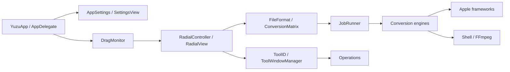
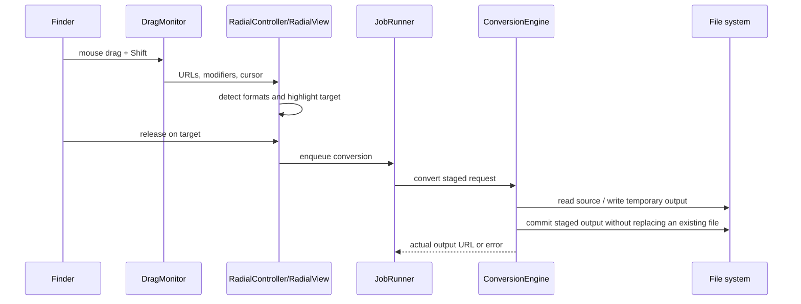
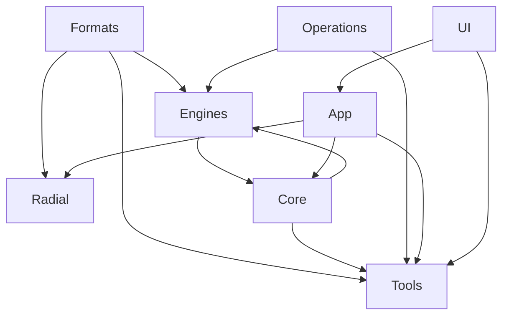
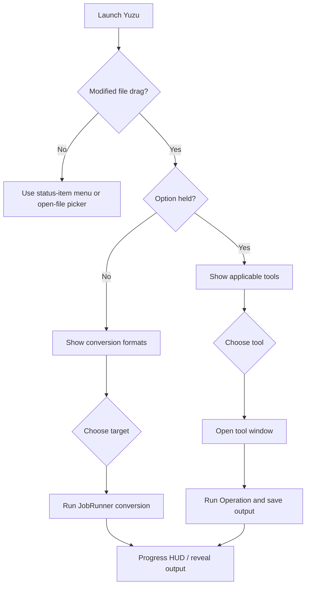

# Yuzu architecture

## System overview

Yuzu is a menu-bar macOS accessory application. `YuzuApp` in `Sources/App.swift` creates the Settings scene and installs `AppDelegate`. `AppDelegate` configures the accessory activation policy, status-item menu, settings window, appearance, and drag monitor. The application has no network service or server component in this repository.

## Lifecycle and UI

`Sources/App.swift` is the `@main` entry point. On launch, `AppDelegate.applicationDidFinishLaunching` starts `DiagnosticLog`, applies `AppSettings`, creates the status item, and starts `DragMonitor` unless screenshot automation is enabled. The status item opens file pickers, tools, settings, logs, and the About panel.

SwiftUI owns Settings, the radial wheel content, tool views, previews, and progress HUD content. AppKit supplies the application delegate, status item, panels, event monitors, drag destination view, native file panels, and window behavior. `Sources/UI/Theme.swift` centralizes the orange accent, semantic label colors, and card surface modifier.

## Drag-and-drop and radial interaction

`Sources/Radial/DragMonitor.swift` observes global mouse down/drag/up events and polls the drag pasteboard. It detects Finder drags, modifier changes, file URLs, and the fallback movement heuristic. `RadialController` maps those events to a `RadialPanel`, detects formats, and chooses either conversion targets or applicable `ToolID` values.

`Sources/Radial/RadialView.swift` is an AppKit drag destination and mouse/keyboard interaction surface. Escape cancels, Return applies the highlighted item, arrow keys move selection, and mouse movement or drag location updates the highlighted wedge. Option switches between conversion and advanced-tool modes while the drag is active.

## Conversion workflow

`FileFormat.detect` identifies supported formats from extensions and aliases. `ConversionMatrix` computes targets, intersections for mixed selections, output names, collision suffixes, and the 253-option total. `JobRunner` creates one asynchronous job per source, limits concurrency with `AsyncSemaphore(limit: 2)`, reports progress, reveals outputs when configured, and presents a card or pill HUD.

`Sources/Engines/ConversionEngine.swift` selects the first supporting engine, writes into a hidden `.yuzu-UUID` sibling, checks cancellation, and moves the completed file or directory into the destination. The dispatcher rejects unsupported matrix pairs and identical source/destination URLs, refuses to replace existing files, removes staging unconditionally, and returns the actual output URL (including multi-page image directories). `JobRunner` uses that URL for Reveal in Finder. Native engines cover images, AVFoundation media, documents, subtitles, and archives; FFmpeg is invoked for unsupported native media formats.

### Document, slide, and spreadsheet formats

| Input | Targets | Backend |
| --- | --- | --- |
| PDF | DOCX, PPTX, XLSX, JPG, PNG, EPUB, TXT, MD | Native PDFKit and package writers |
| TXT | PDF, JPG, PNG, SRT, VTT, DOCX, MD, EPUB, HTML | Native |
| MD, EPUB | PDF, DOCX, MD, TXT, EPUB, HTML, excluding self | Native text pipeline |
| DOCX | PDF, MD, TXT, EPUB, HTML | Optional LibreOffice |
| PAGES, RTF | PDF, DOCX, MD, TXT, EPUB, HTML | Optional LibreOffice, input only |
| RTFD | PDF, DOCX, MD, TXT, EPUB, HTML | AppKit text import, input only |
| PPT, PPTX | PDF, JPG, PNG | Optional LibreOffice, then native PDF rendering for images |
| XLSX, ODS | XLSX, ODS, CSV, TSV, PDF, excluding self | Optional LibreOffice |
| XLS | XLSX, ODS, CSV, TSV, PDF | Optional LibreOffice, input only |
| CSV, TSV | XLSX, ODS, CSV, TSV, PDF, excluding self | Native |

`PresentationWriter.swift` rasterizes each PDF page at 144 DPI into a complete PPTX package with slides, relationships, a blank master/layout, and a theme. Page aspect ratios are fitted into the first page's slide dimensions; objects are images, not editable shapes. `SpreadsheetWriter` creates XLSX worksheets with inline strings, preserving leading zeros and preventing extracted text from becoming formulas; PDF export uses one worksheet per page and one row per text line. It does not reconstruct tables or OCR scanned pages. `SpreadsheetEngine.swift` parses quoted CSV/TSV, writes XLSX/ODS, and renders a basic text PDF.

`DocumentPackage.swift` writes ZIP packages from generated entry names, stores EPUB/ODS mimetypes first and uncompressed, and reads EPUB XHTML in spine order through bounded `unzip -p` pipes without extraction. It rejects unsafe/ambiguous paths, duplicate entries, DTD/entity declarations, oversized XML, and excessive nesting. EPUB input is text-only and does not support encrypted or image-only books. `DocumentEngine.swift` handles TXT/MD/EPUB/RTFD through a text pipeline; Markdown is a distinct format and RTFD attachments are not preserved. Exported HTML contains escaped literal text and never loads external HTML resources.

`OfficeEngine.swift` discovers LibreOffice in Applications or the existing executable search paths. Each request copies its source into a private temporary directory and uses a separate profile, disables macro execution and automatic Writer/Calc link updates, and disables update checks. It checks signatures and nonempty output rather than trusting exit status alone. Paths and filter strings are separate subprocess arguments. Missing LibreOffice produces an actionable error. Filter names and isolated-profile arguments follow the [official LibreOffice conversion filters](https://help.libreoffice.org/latest/en-GB/text/shared/guide/convertfilters.html) and [startup parameter documentation](https://help.libreoffice.org/latest/en-GB/text/shared/guide/start_parameters.html). PAGES is import-only and depends on LibreOffice's import compatibility; PAGES export and text-clipping input are not advertised. CSV/TSV office export writes the first sheet. Layout can change with office filters and installed fonts. No Apple Events permission or application automation is added.

## Modules

- `Sources/Core`: jobs, progress HUD, subprocess wrapper, media probing, diagnostics, and `YuzuError`.
- `Sources/Engines`: conversion protocol and image, audio, video, document, office, spreadsheet, subtitle, archive, AVFoundation, PPTX/XLSX/EPUB package, DOCX, and FFmpeg implementations.
- `Sources/Operations`: advanced-tool backends for images, video, audio, PDFs, metadata, and compression.
- `Sources/Formats`: supported formats, type mapping, conversion matrix, and output naming.
- `Sources/Tools`: SwiftUI tool windows, previews, tool registry, and window manager.
- `Sources/Radial`: global drag tracking, radial controller, panel, shape, and interaction handling.

## Temporary files, errors, and limitations

Temporary work is created under `FileManager.default.temporaryDirectory` or next to the requested destination for atomic staging. Most paths use `defer` cleanup; conversion staging is removed on failure. Errors propagate as `YuzuError`, cancellation, or underlying errors into `JobRunner`.

Current limitations include extension-based format detection, reliance on external FFmpeg/unar/LibreOffice availability for some formats, global event monitoring, an unsigned ad-hoc signing configuration, no declared sandbox entitlement in the repository, and no runtime Finder-drag test on CI. Archive extraction and overwrite behavior deserve additional security hardening before broader distribution.

## Extensibility

Add a format by updating `FileFormat`, its aliases/type mapping, `ConversionMatrix`, the supporting engine, and tests. Add an advanced tool by updating `ToolID`, its applicability and UI registration, the relevant `Operations` backend, and tests. Keep new engines behind `ConversionEngine` and preserve staged output semantics.

## User interaction flow

