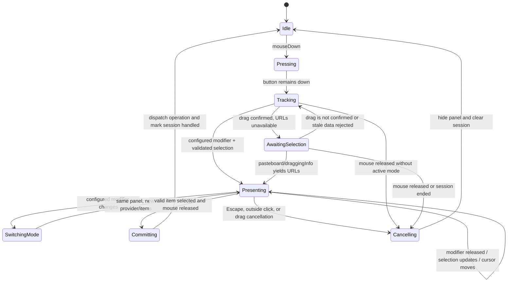

# Yuzu Multi-Modifier Radial Menu Plan

Status: planning only. No application source code is changed by this document.

## 1. Scope and product intent

Yuzu currently provides a Shift-drag radial menu for file conversion and an existing advanced-tool path using Shift+Option. This plan evolves that interaction into three explicit modes while preserving the existing conversion pipeline and current user-visible behavior during migration:

| Mode | Default modifier | Purpose | Current status |
| --- | --- | --- | --- |
| Conversion | Shift | Convert supported files to compatible formats | Existing |
| Tools | Command | Open supported image, video, audio, PDF, metadata, and compression tools | Existing tool implementations; new trigger planned |
| Actions | Control | Perform general file/folder actions independent of conversion support | Not implemented |

The interaction is inspired by the public Tangerine for Mac interaction model: drag a file, tap Shift for conversion, Command for tools, or Control for actions; the wheel remains open until drop or cancellation; the mode keys can be changed in Settings. Yuzu must implement its own architecture, behavior, and visual identity and must not copy proprietary Tangerine branding, assets, or implementation. Reference: [Tangerine for Mac](https://tangerineformac.com/).

### Goals

- Preserve Shift conversion behavior, the current conversion matrix, and the native-first engines.
- Make Command and Control first-class mode selectors without creating three independent drag monitors or controllers.
- Keep the radial open while a drag continues, including after the currently held modifier is released.
- Support files, folders, multiple selections, and mixed selections according to each mode's capability.
- Make unsupported operations absent or visibly unavailable rather than exposing dead actions.
- Make modifier assignments configurable, persistent, conflict-free, and effective without relaunch.
- Improve drag reliability for Finder and Desktop drags, pasteboard timing, cancellation, and multi-monitor/fullscreen placement.

### Non-goals for the first implementation

- Rewriting unrelated conversion engines. The later document-format expansion now provides 253 matrix pairs; see `ARCHITECTURE.md` for implemented formats and backend limitations.
- Treating all file actions as conversion jobs.
- Implementing Float, Quick Preview, or a custom file shelf before their macOS API and UX boundaries are validated.
- Adding a global keyboard shortcut unrelated to an active drag.
- Adding third-party dependencies or copying competitor artwork.

## 2. Current implementation audit

### Application and settings

- `Sources/App.swift` defines `YuzuApp` and the SwiftUI Settings scene.
- `Sources/App/AppDelegate.swift` installs the menu-bar accessory, starts `DragMonitor`, opens file pickers, and owns settings-window creation.
- `Sources/App/AppSettings.swift` persists output location, appearance, FFmpeg path, launch-at-login, JPEG quality, compression, and progress settings through `UserDefaults`.
- `Sources/App/SettingsView.swift` provides General, Appearance, and About settings but has no modifier assignment UI.

### Drag monitoring

`Sources/Radial/DragMonitor.swift` currently:

- Installs global mouse-down, mouse-dragged, and mouse-up monitors.
- Polls `NSEvent.pressedMouseButtons`, `NSEvent.modifierFlags`, the mouse location, and `NSPasteboard(name: .drag)`.
- Records the drag pasteboard `changeCount` at press start and ignores unchanged or older pasteboard contents.
- Uses a Finder-specific movement fallback after 0.3 seconds and 24 points of movement when Shift is held.
- Exposes only Shift and Option through `DragMonitorDelegate`.
- Reads file URLs from the drag pasteboard, standardizes them, and currently excludes directories.
- Ends the modified session when the mouse button is released and can mark a handled session to avoid duplicate completion.

The current fallback can recognize a drag before URLs are available, but that allows an empty radial state. The new design must separate “drag confirmed” from “valid selection available” and prevent empty data from triggering an actionable operation.

### Radial controller and view

`Sources/Radial/RadialController.swift` currently owns one `RadialPanel`, the selected URLs, detected formats, an `advanced` Boolean, picker mode, and outside-click monitoring. It:

- Presents conversion targets when Shift is held.
- Presents `ToolID.available(for:)` when Shift+Option selects advanced mode.
- Reloads items when the Option state changes.
- Adopts later URLs from `NSDraggingInfo` or the drag pasteboard.
- Hides on drag end, cancellation, outside click, or selection.
- Dispatches conversion items to `JobRunner` and tool items to `ToolWindowManager`.

`Sources/Radial/RadialView.swift` is the AppKit drag destination and interaction surface. It handles wedge geometry, mouse movement, `NSDraggingInfo`, Return, Escape, and arrow keys. `RadialAction` currently has only `.convert(FileFormat)` and `.tool(ToolID)` cases.

### Formats, engines, and tools

- `Sources/Formats/FileFormat.swift` detects formats from extensions and aliases and maps them to Uniform Type identifiers.
- `Sources/Formats/ConversionMatrix.swift` computes supported targets, mixed-selection intersections, output names, collision suffixes, and the current 253-conversion total.
- `Sources/Engines/ConversionEngine.swift` chooses a supporting engine, writes to a staged temporary sibling, checks cancellation, and moves the result to the final destination.
- `Sources/Engines/` contains native image, audio, video, document, subtitle, and archive engines plus FFmpeg integration.
- `Sources/Operations/` contains advanced tool backends for images, video, audio, PDFs, metadata, and compression.
- `Sources/Tools/ToolID.swift` defines 25 existing advanced tools, their categories, arity, labels, symbols, and applicability.
- `Sources/Tools/ToolWindowManager.swift` opens the SwiftUI/AppKit tool windows.

Tool applicability is currently format-category based. It is not an action capability system and does not cover folders, mixed file/folder selections, clipboard actions, AirDrop, terminal integration, or move/copy workflows.

### Existing behavior versus planned behavior

| Area | Existing | Planned |
| --- | --- | --- |
| Shift conversion | Supported | Preserve and make one `RadialMode` |
| Shift+Option tools | Supported | Keep as a compatibility path while Command becomes the configured default |
| Command tools | None | Map to existing `ToolID` capability discovery |
| Control actions | None | Add action capability discovery and handlers |
| Files | Supported when format is detected | Preserve for conversion/tools; support actions for all valid file URLs |
| Folders | Currently filtered out by `fileURLs(on:)` | Support in Actions; explicitly define tool/conversion exclusions |
| Empty selection | Can show a waiting/empty wheel after fallback | Never expose actionable items without a validated selection |
| Settings modifiers | None | Persistent, unique, live-updating assignments |

## 3. Proposed architecture

### 3.1 Shared mode model

Introduce a single mode abstraction in the Radial layer, conceptually:

```swift
enum RadialMode: String, CaseIterable, Identifiable {
    case conversion
    case tools
    case actions
}
```

The exact type and file are implementation decisions for the coding phase, but the model must be shared by drag monitoring, controller state, view presentation, settings, diagnostics, and tests. Do not add `ConversionRadialController`, `ToolsRadialController`, and `ActionsRadialController`.

Use a separate selection model rather than assuming every item has a `FileFormat`:

- `FileSelection`: ordered URLs, validated file/folder kind, source application/context if available, and a drag-session identity.
- `RadialItem`: existing conversion/tool cases plus a planned action case.
- `RadialModeProvider`: maps a `FileSelection` and mode to supported items and an empty-state reason.
- `RadialActionHandler`: executes conversion, tool, or file-action items through the appropriate subsystem.

This keeps `ConversionMatrix`, `ToolID`, and new file actions independent while giving `RadialController` one presentation and selection lifecycle.

### 3.2 Capability providers

Mode providers should be pure or mostly pure so they can be unit tested without a live drag:

1. Conversion provider calls `FileFormat.detect` and `ConversionMatrix.targets(for:)`. It returns only targets supported by the current engine registry. Mixed selections use the existing intersection rule.
2. Tools provider calls `ToolID.available(for:)` and retains current arity/category checks. Any tool that cannot operate on folders or mixed selections remains absent.
3. Actions provider evaluates file and folder capabilities independently of detected formats. It can offer Copy, Move, Copy Path, AirDrop, Open in Terminal, and a validated Quick Preview/Float item when their handler and selection requirements are satisfied.

The provider must distinguish:

- no URLs yet: waiting state, no executable items;
- URLs present but unsupported: informative empty state;
- mixed selection: items supported for every selected entry, or explicitly marked as mixed-selection actions;
- operation unavailable on the current macOS or selection: omit it or expose a disabled item with a reason, consistently across modes.

### 3.3 Unified drag state

Refactor `DragMonitorDelegate` around a state/update payload rather than separate Shift/Option booleans. The payload should include the current modifier flags, resolved `RadialMode?`, cursor location, drag-session identity, and selection availability. `RadialController` remains the single consumer and owns the panel.

The monitor must remain responsible for observing the system; it must not execute conversions, tools, or file actions. The controller must not reread global state in a way that races the monitor; mode and selection updates should be delivered in order on the main thread.

### 3.4 Mode selection rules

Settings store one physical modifier per mode. The default mapping is:

| `RadialMode` | Default `NSEvent.ModifierFlags` |
| --- | --- |
| conversion | `.shift` |
| tools | `.command` |
| actions | `.control` |

The settings validator rejects duplicate assignments. If multiple configured modifiers are held accidentally, the implementation must use deterministic “most recently pressed configured modifier wins” behavior, tracked per drag session. When the active modifier is released while another configured modifier remains held, switch to the remaining mode. When all configured modifiers are released, keep the last mode and keep the wheel open until drop, Escape, or drag-session end.

The existing Shift+Option tools path should remain as a migration compatibility alias while Command tools are introduced. The compatibility rule must be explicit, logged as legacy behavior, covered by tests, and removable in a later release; it must not make a user-configured collision silently valid.

## 4. Modifier interaction state machine

The desired interaction is a drag-session state machine, not three independent shortcut handlers.



Required state invariants:

- A normal unmodified drag is invisible to Yuzu and must continue to Finder or the originating application unchanged.
- A radial panel has one drag-session identity and one selected URL snapshot at a time.
- Mode changes replace only the provider/items and mode presentation; they do not reset the drag session, cursor center, or valid selection.
- A drop executes at most once. `markHandled()` and the session identity must prevent duplicate execution from both global mouse-up and `NSDraggingInfo` callbacks.
- Escape and cancellation clear the panel without invoking an operation.
- A mouse release with no valid highlighted item never executes an operation.

## 5. Technical implementation phases

### Phase 0 — Baseline and compatibility contract

- Add tests around current Shift conversion, Shift+Option tools, Escape, Return, arrow-key selection, mixed-format intersections, and duplicate prevention.
- Record current drag behavior on Finder, Desktop, multiple files, and unsupported files on a supported macOS environment.
- Define the compatibility policy for Shift+Option before changing mode detection.
- Keep this phase source-compatible and do not alter the conversion matrix.

### Phase 1 — Refactor drag state and selection data

- Replace the Shift/Option-only delegate contract with a mode-aware drag-session update.
- Introduce a validated selection representation that can retain files and folders without forcing conversion format detection.
- Separate pasteboard refresh, URL validation, stale-session rejection, and mode resolution.
- Preserve the current panel and conversion/tool handlers behind the new model.
- Ensure directories are not passed to conversion engines or tools that cannot support them.

### Phase 2 — Multi-modifier mode switching

- Add configurable `RadialMode` and default Shift/Command/Control mapping in the controller/monitor.
- Detect newly pressed and released configured modifiers during one drag.
- Keep the panel open on modifier release and switch the provider in place.
- Add deterministic handling for simultaneous modifiers and the legacy Shift+Option tools alias.
- Add mode-specific title, center label, symbol, and empty-state copy without duplicating radial geometry.

### Phase 3 — Command tools integration

- Map Command mode to the existing `ToolID` provider and `ToolWindowManager`.
- Preserve all current tool applicability, arity, progress, output, and error behavior.
- Hide unsupported tools for folders, mixed selections, and unavailable dependencies.
- Keep Shift+Option behavior available during the migration window and document the eventual deprecation separately.

### Phase 4 — Control actions

Implement actions behind a new action provider/handler, with explicit capability and error handling:

- **Copy**: write file and folder URLs to the general pasteboard using Foundation/AppKit APIs.
- **Copy Path**: write one standardized path per selected URL as text; define newline and empty-selection behavior.
- **Move**: present a destination folder picker, validate destination/collision behavior, and move originals only after confirmation.
- **AirDrop**: use the native sharing API (`NSSharingService`/sharing picker) where available; do not shell out.
- **Open in Terminal**: use an explicit supported terminal application integration and `NSWorkspace`; do not build a shell command from user paths.
- **Quick Preview**: evaluate Quick Look APIs and selection support; keep it planned until lifecycle and permissions are proven.
- **Float**: treat as a separate shelf/window feature, not a trivial file action; keep it future enhancement until a clear ownership and persistence model exists.

Every action needs cancellation, collision, permissions, mixed-selection, and failure behavior. File actions must not enter `JobRunner` unless they truly need asynchronous job progress.

### Phase 5 — Settings and live configuration

- Add a Settings section for Conversion Modifier, File Tools Modifier, and File Actions Modifier.
- Persist a stable raw representation in `UserDefaults`, with defaults for fresh installs and migration handling for future key changes.
- Validate uniqueness before saving and show a direct conflict message.
- Publish changes through `AppSettings` so the active `DragMonitor`/`RadialController` reads the current mapping without relaunch.
- Define whether settings changes during an active drag apply immediately or at the next drag; recommended behavior is next drag to avoid changing semantics mid-session.
- Add accessibility labels and a non-keyboard alternative for modifier assignment if required by the chosen control.

### Phase 6 — UX, animation, and platform behavior

- Add distinct but consistent mode identity using SF Symbols, center labels, semantic colors, and accessible text.
- Animate only the item/provider transition; keep the panel center stable and make transitions interruptible.
- Define loading/waiting, no-supported-items, invalid-selection, success, failure, and cancellation feedback.
- Revalidate panel placement on the screen containing the cursor, including multiple monitors, changed screen coordinates, fullscreen spaces, and the notch area.
- Test light/dark appearance, reduced motion, VoiceOver labels, keyboard navigation, and mouse-only radial targeting.

### Phase 7 — Reliability, testing, and rollout

- Run unit, integration, manual Finder/Desktop, permission, and regression tests from the checklist below.
- Compare current Shift conversion outputs before and after the refactor.
- Roll out Command tools and Control actions behind small, reviewable changes; do not combine action implementation with a conversion-engine rewrite.
- Document final behavior and remove the compatibility alias only after an intentional migration decision.

## 6. Drag-and-drop reliability plan

### Sources and timing

Support Finder windows and Desktop by treating `NSPasteboard(name: .drag)` and `NSDraggingInfo.draggingPasteboard` as complementary sources. At press start, capture a session-specific `changeCount`; accept only updates observed after that count. Never reuse URLs from a previous session.

When the drag is confirmed but the pasteboard has no URLs yet:

1. Keep the session in `AwaitingSelection`.
2. Continue polling at the existing drag interval and accept later pasteboard changes.
3. Let the radial panel show a non-actionable waiting state only after the drag is positively confirmed, not merely because a modifier is held.
4. Replace the waiting state immediately when valid URLs arrive.
5. Cancel and clear the session if the mouse is released, the pasteboard becomes stale, or the drag session ends.

The fallback movement heuristic should be generalized beyond “Finder + Shift” only after testing Desktop behavior. It must not manufacture a usable selection and must not cause a normal unmodified drag to be intercepted.

### Selection rules

- Accept regular files and folders as URL entries for Actions.
- Preserve input order for user-facing action results.
- Deduplicate identical standardized URLs while preserving order.
- Keep mixed file/folder selections valid for actions that explicitly support them.
- Detect formats only for conversion/tool capability calculation; a folder is not an unsupported file format.
- Do not expose conversion or tool items when any required entry cannot be processed by that operation.

### End and cancellation rules

Handle global mouse-up, `draggingEnded`, `draggingExited`, outside click, Escape, and selection execution through one idempotent session teardown. Teardown must invalidate timers, clear active URLs and pasteboard state, remove monitors, end process activity, hide the panel, and prevent a second handler from executing the operation.

## 7. Dependencies and compatibility

- Keep SwiftUI and AppKit as the primary UI stack and preserve the Brisk manifest.
- Continue targeting arm64 and the existing macOS 26 deployment target; do not lower it to obtain APIs.
- Prefer Foundation/AppKit APIs: `NSPasteboard`, `NSWorkspace`, `NSOpenPanel`, `NSSharingService`, and Quick Look only after API availability is verified.
- No new third-party dependency is required by the initial architecture.
- AirDrop availability, Terminal/iTerm integration, Quick Look, and Float behavior require runtime verification on supported macOS versions.
- Global event monitors may involve Accessibility/Input Monitoring behavior depending on the final event-monitor design; verify on clean machines and document actual requirements.
- If Yuzu later adopts App Sandbox, redesign file access around security-scoped URLs/bookmarks and review launch-at-login, sharing, terminal, and temporary-directory behavior.

## 8. Permission and security considerations

- Treat drag paths, folder contents, archive entries, metadata, clipboard contents, and configured external executable paths as untrusted.
- Never interpolate file paths into shell commands. Continue using `Process.executableURL` and argument arrays through `Shell`.
- Move must not silently overwrite an existing destination. Define a collision policy before implementation and cover it with tests.
- Copy and Copy Path must make the clipboard contents explicit to the user and avoid logging sensitive paths.
- AirDrop and Terminal are user-invoked integrations; do not claim they are sandbox-safe or permission-free without verification.
- Quick Preview and Float must not retain file URLs or media longer than necessary.
- Do not claim Yuzu is fully offline, sandboxed, or completely secure solely because the default conversion path is local-first.

## 9. Edge cases

- Modifier pressed before the pasteboard publishes URLs.
- Modifier released while the wheel is open.
- Switching directly from Shift to Command, Control to Shift, or between any configured pair.
- Multiple configured modifiers held at once.
- User changes settings while a drag is active.
- Empty, stale, malformed, non-file, inaccessible, or security-scoped URLs.
- One file, many compatible files, mixed formats, folders, mixed files/folders, and duplicate URLs.
- Unsupported formats with valid action capabilities.
- Drop outside the wheel, drop on the center, Escape, right-click, focus loss, screen change, display disconnect, and fullscreen spaces.
- Existing destination names, read-only sources, read-only destinations, and cross-volume moves.
- Missing FFmpeg/unar, canceled tools, partial outputs, and a failed AirDrop or Terminal launch.
- Accessibility, reduced motion, dark appearance, VoiceOver, keyboard-only navigation, and high-DPI displays.

## 10. Acceptance criteria

### Conversion mode

- Shift shows only targets returned by the existing matrix and supporting engine.
- Existing one-file, multiple-compatible-file, mixed-selection, collision, progress, cancellation, and output behavior remains intact.
- Releasing Shift alone does not close the wheel while the drag continues.

### Tools mode

- Command shows only applicable existing `ToolID` entries.
- Existing advanced tools continue to open and report progress/errors as before.
- Unsupported file/folder selections never expose an executable tool item.
- Shift+Option compatibility behavior is either preserved and tested or removed only through an explicit migration decision.

### Actions mode

- Control shows only implemented actions supported by the current selection.
- Copy, Copy Path, Move, AirDrop, and Terminal behavior is explicit, cancelable, and tested before being marked implemented.
- Folders and mixed selections work for actions that claim to support them.
- Float and Quick Preview remain visibly planned/unavailable until implemented and validated.

### Interaction and settings

- The radial stays open after modifier release and switches modes within one drag session.
- Normal unmodified dragging is not intercepted.
- Escape, outside click, drag cancellation, and mouse-up with no target are safe and idempotent.
- Default modifiers are Shift/Command/Control, persisted settings reject duplicates, and valid changes apply to the next drag without relaunch.
- Mode transitions are stable on Finder, Desktop, multiple monitors, and fullscreen spaces.

## 11. Testing checklist

### Unit tests

- `RadialMode` and modifier-assignment uniqueness.
- Modifier state transitions, most-recently-pressed precedence, release behavior, and legacy Shift+Option compatibility.
- Provider output for single files, multiple compatible files, mixed formats, folders, mixed files/folders, unsupported formats, and empty selections.
- Pasteboard `changeCount` freshness and URL deduplication/order.
- Action capability filtering and collision-policy decisions.
- Existing conversion matrix, tool applicability, output naming, and error behavior.

### Integration tests

- One drag session switching Shift → Command → Control without creating a second panel or losing selection.
- Delayed pasteboard URL publication and `NSDraggingInfo` URL adoption.
- Mouse-up, `draggingEnded`, `draggingExited`, Escape, outside click, and duplicate-execution prevention.
- Settings persistence, migration/defaults, conflict validation, and live application on the next drag.
- Copy/pasteboard, move/collision, AirDrop invocation, Terminal invocation, and Quick Look when implemented.

### Manual macOS tests

- Finder file and folder drags.
- Desktop file and folder drags.
- Single, multiple, mixed, inaccessible, and unsupported selections.
- Modifier press/release/switch sequences and normal drag passthrough.
- Multiple monitors, fullscreen, different display scales, light/dark appearance, reduced motion, VoiceOver, and keyboard-only selection.
- Accessibility/Input Monitoring prompts and behavior on clean supported installations.
- Missing external tools, canceled operations, read-only destinations, cross-volume move, and duplicate output names.

## 12. Risks and mitigations

| Risk | Mitigation |
| --- | --- |
| Global monitor changes intercept normal drags | Preserve an explicit unmodified path, require confirmed drag/session data, and test Finder/Desktop passthrough. |
| Command or Control conflicts with Finder/app behavior | Observe only during an active drag, use a deterministic mode state machine, test native drag semantics, and allow configurable modifiers. |
| Empty or stale pasteboard data produces a wrong operation | Session-scoped `changeCount`, URL validation, waiting state, and no actionable items without a valid selection. |
| Replacing `advanced` breaks current Shift+Option users | Introduce `RadialMode` behind compatibility tests and retain the alias during rollout. |
| Folder support leaks into format/tool engines | Keep file-kind capability checks separate from `FileFormat` and never pass unsupported folders to engines. |
| Move or archive-like actions cause data loss | Require explicit destination/collision policy, stage where possible, and test failures/cancellation. |
| AirDrop/Terminal/Quick Look availability differs by OS | Use native APIs with availability checks, isolate handlers, and mark unsupported items unavailable. |
| App Sandbox later changes file access | Design a security-scoped URL/bookmark boundary before enabling sandbox packaging. |
| Three modes create visual and accessibility overload | Reuse radial geometry, provide mode identity through label/icon/state, and test VoiceOver/reduced motion. |

## 13. Recommended implementation order

1. Establish regression tests and record current Shift and Shift+Option behavior.
2. Refactor `DragMonitor` and `RadialController` around a session and `RadialMode` without changing conversion execution.
3. Add Command mode backed by the existing tool provider and retain the legacy alias.
4. Add mode switching and modifier-release semantics with one panel and one controller.
5. Add persisted modifier settings and conflict validation.
6. Add file actions incrementally, starting with Copy Path and Copy, then Move, AirDrop, and Terminal.
7. Evaluate Quick Preview and Float as separately scoped enhancements.
8. Add mode-specific UX, accessibility, animation, multi-monitor handling, and final documentation.
9. Run the complete test/manual checklist and make the migration decision for Shift+Option.

## 14. Source files expected to change in the implementation phase

This planning task intentionally does not modify these files. A later implementation should expect to review or change:

- `Sources/Radial/DragMonitor.swift` — modifier flags, pasteboard timing, session lifecycle, folder acceptance, and delegate payload.
- `Sources/Radial/RadialController.swift` — `RadialMode`, provider selection, state machine, compatibility alias, and action dispatch.
- `Sources/Radial/RadialView.swift` — mode presentation, item model, empty/loading states, keyboard behavior, animation, and accessibility.
- `Sources/App/AppSettings.swift` and `Sources/App/SettingsView.swift` — persistent modifier assignments, validation, and live settings behavior.
- `Sources/Formats/ConversionMatrix.swift` and `Sources/Formats/FileFormat.swift` — only if capability filtering needs a clearer file-selection boundary; do not change conversion semantics unnecessarily.
- `Sources/Tools/ToolID.swift` and `Sources/Tools/ToolWindowManager.swift` — retain tool capability checks and route Command-mode selections.
- A new Radial action capability/handler area — implement file actions without coupling them to conversion engines.
- `Sources/Core/JobRunner.swift` — only if action progress/cancellation requires a shared job abstraction; do not force synchronous clipboard actions into the conversion queue.
- `Tests/YuzuTests.swift` — mode, settings, selection, state-machine, provider, and regression coverage.
- `docs/ARCHITECTURE.md`, `docs/DESIGN.md`, `docs/SECURITY.md`, and `docs/DEVELOPMENT.md` — update after behavior is implemented and verified.

No implementation should begin until the mode precedence, folder semantics, compatibility policy, action collision policy, and permission behavior have been reviewed.
